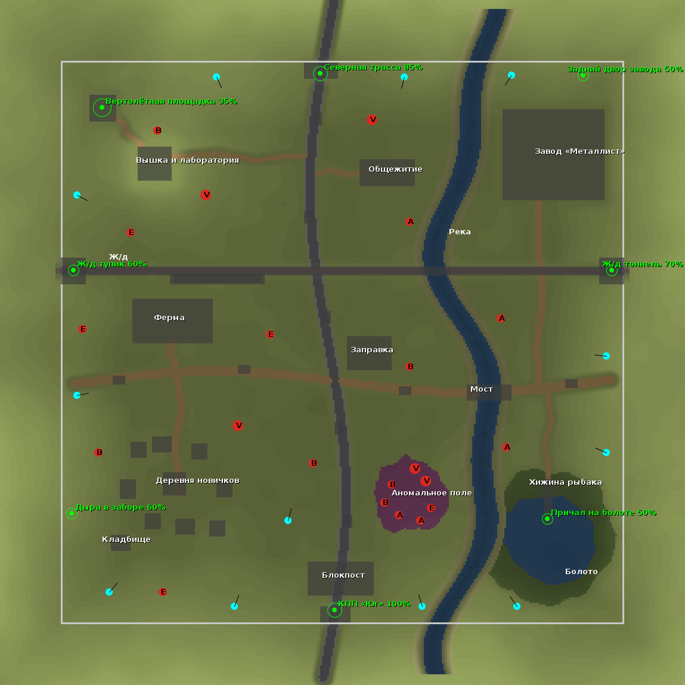

# Zone Raids — рейды с эвакуацией для Forge 1.20.1

Серверный мод в духе Escape from Tarkov / S.T.A.L.K.E.R.: игроки собираются в хабе, встают в очередь на карту,
уходят в рейд по таймеру, лутают ящики и должны дойти до своей точки эвакуации. Смерть = потеря снаряжения,
не успел эвакуироваться = «пропал без вести» (снаряжение тоже теряется). Мод нужен и на сервере, и на клиенте.

## Что есть

| Механика | Как работает |
|---|---|
| Хаб | Точка `/raidadmin sethub`. Вне рейдов PvP выключен (настраивается). |
| Терминал рейдов | Блок + клавиша **K** + `/raid`. Список карт, очередь, статус рейдов, схрон, группа, статистика. |
| Очередь и матчмейкинг | Минимум/максимум игроков на карту, обратный отсчёт, при полном лобби отсчёт сокращается. |
| Группы (сквады) | `/raid party invite/accept/leave/kick`. Группа встаёт в очередь целиком, спавнится вместе и получает общие выходы. |
| Сессии рейдов | По одной сессии на карту одновременно, разные карты идут параллельно. Таймер, предупреждения о времени. |
| Эвакуация | Зоны с радиусом и шансом открытия на рейд. Каждой группе выдаётся случайный набор выходов. Нужно простоять N секунд в зоне. |
| Потеря снаряжения | Смерть в рейде: всё выпадает на карте (даже при `keepInventory`). Конец таймера: инвентарь стирается. |
| Схрон | Личное хранилище на 54 слота, хранится в файле игрока. Недоступно в рейде. |
| Торговец | Прилавок в оружейке бункера (ПКМ) или кнопка «Торговец» в терминале. Скупает артефакты, продаёт оружие, броню, патроны и медицину. Деньги в рейде не теряются. Подробнее ниже. |
| Ящики с лутом | 4 типа ящиков (обычный, военный, медицинский, оружейный), перезаполняются один раз за рейд при первом открытии. Таблица лута меняется командой. |
| Анти-абуз | В рейде запрещены: ломать/ставить блоки, эндер-сундук, порталы и чужие телепорты, `/home`, `/spawn`, `/tpa` и т.п. |
| Переподключение | Вышел из игры в рейде и вернулся до конца таймера — продолжаешь рейд. Рейд закончился без тебя — MIA. Перезапуск сервера — возврат в хаб со снаряжением (настраивается). |
| HUD | Панель в стиле КПК в правом верхнем углу: карта и таймер (последняя минута мигает красным), раунд, цель раунда и назначенные выходы со стрелкой направления и расстоянием, полоса эвакуации. Опускается под иконки эффектов, чтобы не перекрывать их. |
| Управление | Раскладка клавиш всех модов без пересечений, ставится сама при первом запуске. Таблица: [modpack/README.md](modpack/README.md#управление). |
| Интерфейс | Терминал, перки, торговец и карта в одном стиле КПК. **K** открывает и закрывает терминал, колесо мыши листает карты. На бумажной карте Кордона в рейде отмечены ваши выходы и цель раунда. Главное меню: панорама Зоны (пасмурное небо, лесополоса, ЛЭП, водонапорная башня), фон списков и настроек: тёмный бетон. Только заливки и текст, на слабых видеокартах ничего не стоит. |
| Наблюдение | Кнопка «Наблюдение» в терминале: список игроков в рейдах (карта, раунд, сколько осталось), **Смотреть** ставит камеру на игрока, вы видите его глазами и его HUD. Когда игрок погиб или вышел, камера переходит к другому игроку того же рейда. **Shift** (присесть) или «Вернуться в хаб» возвращает ровно туда, откуда смотрели, даже после вылета или перезахода. Участник идущей сессии видит только свою группу, в мясорубке никого. Зрителей не слышно в голосовом чате, взаимодействовать с картой они не могут. Отключается `spectating = false` в `[hub]`. |
| Питбайки | Двухместный мотоцикл: **ПКМ** сесть (первый садится за руль), **W/S** газ и тормоз, **A/D** руль, **Shift** слезть. Появляются на дорогах карты в начале рейда и исчезают в конце. Подробнее ниже. |

## Сессия из трёх раундов и перки

Очередь запускает не один рейд, а **сессию**: три раунда на одной карте с одними и теми же игроками.
Между раундами минута в хабе (`intermissionSeconds`), схрон в это время доступен, встать в другую очередь нельзя.
Следующий раунд начинается сам: за 10 секунд идёт обратный отсчёт, потом всех участников сессии переносит на карту
(наблюдателей тоже). Кто в этот момент лежал мёртвым или был не в сети, попадает в раунд сам, как только возродится
или зайдёт, если это случилось в первые `lateJoinSeconds` секунд раунда (по умолчанию 60). Один раз за раунд: погибший
в раунде обратно не возвращается.

| Раунд | Что происходит |
|---|---|
| 1. Эвакуация | Обычный рейд: лут, свои выходы, не успел — пропал без вести. |
| 2. Случайный режим | Один из трёх (`secondRoundModes`), объявляется в начале перерыва. |
| 2а. Сброс груза | В середине карты падает военный груз (столб дыма). Группа должна простоять в его зоне `dropCaptureSeconds` секунд без чужих игроков рядом: если в зоне две группы, захват стоит, если зона пуста, прогресс тает. Захватили — на земле лут из `dropLootTable`, дальше эвакуация. |
| 2б. Выброс | Выходов нет. Безопасная зона сужается к случайному укрытию, снаружи урон, который растёт каждые 10 секунд. Дожил до конца внутри — сохранил снаряжение. |
| 2в. Документы | Случайный игрок получает «Секретные документы» и подсвечен для всех, в HUD у остальных расстояние до документов. Вынес через выход — +2 очка перков. Убили — документы выпадают, их можно подобрать (лежащие тоже светятся). Потерялись больше чем на 15 секунд — выдаются заново. |
| 3. Мясорубка | Все против всех, группы не спасают, у каждого свой спавн. Выходов нет, зона сужается к центру карты. Последний живой побеждает, остальные выжившие по таймеру тоже сохраняют результат. Нужно минимум 2 игрока. |

Умер в раунде — вернулся в хаб без снаряжения, но остаёшься в сессии и идёшь в следующий раунд с тем, что лежит в схроне.
Каждый раунд ящики на карте перезаполняются, артефакты в аномалиях и враги появляются заново. В мясорубке врагов нет.

**После конца сессии сбрасывается всё**: инвентарь, слоты Curios, эндер-сундук, схрон, эффекты. Остаются только перки,
статистика и деньги торговца (`keepMoneyAfterSession`). Если игрока не было в сети, сброс произойдёт при входе. Перезапуск сервера тоже заканчивает сессию.
`/raidadmin stop` прерывает сессию без сброса (все возвращаются со снаряжением). В начале сессии каждый получает
стартовый набор `starterKit`. `rounds = false` возвращает старое поведение: один раунд, без сброса.

**Торговец.** В оружейке бункера (юго-восточный угол хаба) стоит прилавок торговца: ПКМ по нему или кнопка
«Торговец» в терминале (**K**) открывают окно торговли. Вкладка «Продать» показывает, какие артефакты он скупает,
по какой цене и сколько их у вас в инвентаре: «1 шт» продаёт один, «Все» продаёт все такие. Надетые в слоты Curios
(**I**) артефакты сначала нужно снять. Остальные вкладки (оружие, броня, патроны, медицина) продают снаряжение за
деньги. Наведите мышь на иконку, чтобы увидеть описание предмета (у артефактов там их эффект). Торговать можно только вне рейда:
в хабе и между раундами сессии. Деньги не предмет: их нельзя выронить или потерять в рейде, и по умолчанию они
переживают конец сессии (`keepMoneyAfterSession`), а купленное снаряжение стирается вместе с инвентарём. Цены
настраиваются в секции `[shop]` конфига, проверка, что все предметы прайса установлены: `/raidadmin shop check`.
Выдать деньги: `/raidadmin money <игрок> set|add <сумма>`. На уже построенном хабе прилавок появляется при
следующем запуске сервера.

**Набор на раунд.** В начале каждого раунда (и в одиночном рейде) игрок получает базовое снаряжение из таблицы лута
`roundKitLootTable` (по умолчанию `zoneraids:kits/round_start`: Glock 17 с полным магазином, 34 патрона 9 мм, каска,
форма, штаны и ботинки Fracture Point, бинт). Броня надевается только в пустые слоты, оружие выдаётся только тем, у кого
его нет, патроны и бинт выдаются всегда. Так погибший в прошлом раунде не выходит с пустыми руками, а выживший не
копит одинаковые пистолеты. Пустая строка в `roundKitLootTable` отключает набор.

**Перки** покупаются за очки: эвакуация +1, убийство игрока не из своей группы +1, захват груза +1, документы +2,
пережил выброс или мясорубку +1, победа в мясорубке +2, сессия пройдена до конца +1. Уровень N стоит N очков,
максимум 3 уровня. Меню: кнопка «Перки» в терминале, или `/raid perks` и `/raid perk <id>`.

| Перк | За уровень |
|---|---|
| Полевая медицина (`field_medic`) | лечение +8%, еда и питьё быстрее на 10% |
| Атлетика (`athlete`) | скорость передвижения +2% |
| Тихий шаг (`quiet_step`) | шаги для других игроков тише на 15%, мобы и NPC замечают на 8% ближе |
| Умение падать (`fall_training`) | урон от падения −12% |
| Ориентирование (`orientation`) | эвакуация быстрее на 10% |

Админ: `/raidadmin perks <игрок> points <n>`, `/raidadmin perks <игрок> reset`.

## Готовый мир: хаб и карта «Кордон»

Ничего настраивать не нужно. При первом запуске сервера мод сам строит (по 25 мс за тик, сервер не подвисает,
операторам в чат идёт прогресс):

* **Хаб** в измерении `zoneraids:hub`: закрытый бункер-лагерь сталкеров с терминалами рейдов, схроном,
  баром «Последний рубеж», койками, медпунктом, оружейкой с прилавком торговца и табличками «как играть». Точка хаба ставится
  автоматически, игроки вне рейда попадают в хаб при входе и после возрождения. Ломать и ставить блоки
  в хабе нельзя (кроме творческого режима).
* **Карту «Кордон»** в измерении `zoneraids:cordon` (320×320, свой серо-зелёный туманный биом с пеплом
  в воздухе, без мобов): деревня новичков с кладбищем, колхозная ферма с силосной башней, армейский блокпост
  с вышкой, заправка, трёхэтажное общежитие с обрушенным крылом, завод «Металлист» с цехом, складом,
  контейнерами и трубой со снайперской площадкой, железная дорога с вагонами, мостом и тоннелем, холм
  с радиовышкой и подземной лабораторией, вертолётная площадка, болото с хижиной и причалом, аномальное
  поле, ещё 14 одиночных аномалий по всей карте, река с автомобильным мостом, ЛЭП, брошенные машины и
  периметр из бетонного забора. Около 70 ящиков с лутом (обычные, военные, медицинские), на 60% военных и 25% обычных
  сверху стоит оружейный ящик (в нём всегда ствол, 2–3 пачки патронов). На уже построенном Кордоне оружейные ящики
  доставляются при следующем запуске сервера, без перестройки карты. 12 точек
  спавна по краям, 8 выходов с разным шансом открытия. Длительность рейда 25 минут, 1–12 игроков.



**Аномалии.** На Кордоне 21 аномалия: 7 на аномальном поле и 14 одиночных, их видно по частицам и выжженной
земле. Электра бьёт током и замедляет, Жарка поджигает, Воронка затягивает к центру и подбрасывает,
Кисель травит. В начале каждого рейда в части аномалий (`artifactChance`, по умолчанию 45%) появляется
артефакт: светящийся предмет в центре аномалии, за которым надо залезть. Список артефактов задаётся
в `artifactItems` (по умолчанию артефакты Anomaly Zone; отсутствующие id пропускаются), урон множителем
`damageMultiplier`. Вынесенный артефакт можно надеть в слот Curios (**I**), его эффект задаёт Anomaly Zone и виден
в подсказке предмета, или продать торговцу в хабе. Аномалии работают, только пока рядом есть игрок рейда. На бумажной карте они отмечены
красными треугольниками.

**Карта Кордона** — бумажная карта-предмет: ПКМ открывает план с выходами, а на Кордоне на нём отмечено, где вы
стоите и куда смотрите. Игра при этом не ставится на паузу. В хабе у каждого игрока карта есть всегда
(`giveMapInHub`); в рейде её можно потерять вместе с остальным снаряжением.

Карта регистрируется как `cordon`, со спавнами, выходами и границей зоны: игрока в рейде, который
перелез через забор (крюком, элитрами), возвращает внутрь. Карта одинаковая на любом сервере, от сида
мира не зависит. Перестроить: `/raidadmin build hub`, `/raidadmin build cordon` (если на карте нет рейда),
прогресс: `/raidadmin build status`. Отключить автопостройку: `autoSetup = false` в секции `[world]` конфига.
Блоки аномалий из стороннего мода можно добавить на аномальное поле списком `anomalyBlocks` (отсутствующие id пропускаются).

На карте нет ванильных сундуков, бочек и прочих хранилищ, чтобы лут нельзя было спрятать между рейдами.
Из «живых» блоков только пара костров. Мобы на карте сами не появляются, только враги рейда (см. ниже).

## Враги: мутанты, бандиты, военные

На Кордоне 12 точек врагов. Группа появляется один раз за рейд, когда игрок рейда подходит к точке ближе
радиуса срабатывания (обычно 40 блоков), и не ближе 12 блоков к игроку. У каждой точки свой шанс, так что
каждый рейд расклад разный. Деревня новичков спокойная.

| Тип (`kind`) | Кто | Где на Кордоне |
|---|---|---|
| `blind_dog` | Слепой пёс: быстрый, слабый, стаей по 2–4, прыгает | поля между деревней и фермой, у общежития, за рекой |
| `flesh` | Плоть: медленная, живучая, таранит и подбрасывает | колхозная ферма |
| `snork` | Снорк: прыгает на цель с нескольких метров | аномальное поле, болото |
| `bloodsucker` | Кровосос: невидим, пока подкрадывается, проявляется с визгом вблизи или от попадания, лечится ударами | подземная лаборатория |
| `bandit` | Бандиты [TACZ] NPCs с пистолетами, дробовиками, иногда АК | заправка, общежитие, завод |
| `military` | Военные [TACZ] NPCs с автоматами в армейской броне | блокпост, холм с вышкой |

Мутанты встроены в Zone Raids (ванильные модели и текстуры волка, зоглина, хаска и утопленника), сторонний мод
для них не нужен. Бандиты и военные требуют мод [TACZ] NPCs (в сборке есть); без него эти точки пустые.
Их шаблоны `zr_bandit` и `zr_military` лежат в `config/tacznpc_loadouts.json` модпака: стреляют по игрокам,
друг друга и мутантов не трогают. Если NPC стоит без цели, Zone Raids сам наводит его на игрока в прямой
видимости ближе 24 блоков.

* **Лимиты под слабое железо** (секция `[enemies]` конфига): не больше 14 врагов одновременно на рейд
  (`maxAlivePerRaid`) и из них не больше 6 вооружённых NPC (`maxNpcsPerRaid`). Враги появляются только рядом
  с игроками, а не все сразу при старте. `enabled = false` выключает врагов совсем.
* **Урон по игроку**: ни один удар или пуля врага не наносит больше 3,5 урона (`maxDamagePerHit`) до брони,
  так что с полным здоровьем любую часть тела (у головы в First Aid 4 HP) одним попаданием не убить. Пули NPC
  ослаблены до 35% (`npcDamageMultiplier`), мутантов можно ослабить `mutantDamageMultiplier`. Укус пса 2,
  плоть и снорк 3–3,5, кровосос 5 (упирается в лимит). Оружие NPC стоит на одиночном огне.
  Группа не появляется ближе 12 блоков к игроку (у маленьких точек вроде лаборатории ближе 6–7): если места нет,
  она ждёт, а не возникает вплотную.
* **Без утечек**: каждый враг помечен номером своего рейда. В конце рейда все загруженные враги удаляются,
  а враг из выгруженного чанка или после перезапуска сервера удаляется в момент загрузки. Сессия хранит только UUID.
* **Лут**: с убитого врага падает таблица `zoneraids:enemies/<kind>`, снаряжение вооружённых врагов берётся из
  `zoneraids:enemies/<kind>_gear` (оружие в руку, броня по слотам), каждый предмет снаряжения выпадает с шансом
  `gearDropChance` (15%). В моде лежат ванильные таблицы, модпак подменяет их на патроны TaCZ, бинты First Aid,
  броню Fracture Point и артефакты (у кровососа).
* **Свои типы**: список `types` в секции `[enemies]`, строки вида `kind=entity_id` или `kind=entity_id{nbt}`,
  так можно подключить мобов любого мода. Проверка: `/raidadmin enemy types`.
* **Свои точки**: встаньте на место и `/raidadmin map addenemy <map> <kind> <min> <max> <шанс> [радиус]`,
  очистить `/raidadmin map clearenemies <map>`, список в `/raidadmin map info <map>`.
  Тестовый спавн без рейда: `/raidadmin enemy spawn <kind> [count]` (такие враги убираются при старте или конце
  следующего рейда на этой карте).
* Сложность «Мирная» удаляет враждебных мобов, для рейдов нужна «Лёгкая» и выше.

## Настройка карты (для администратора)

Мод добавляет два измерения: `zoneraids:zone` (обычная генерация, можно играть сразу) и `zoneraids:void`
(пустота, чтобы вставить свою карту через WorldEdit/схематики). Карта может быть и в любом другом измерении.

```
/execute in zoneraids:zone run tp @s 0 120 0      # перейти в измерение карты
/raidadmin map create forest                       # создать карту в текущем измерении
/raidadmin map name forest Лес у Кордона
/raidadmin map duration forest 25                  # минут
/raidadmin map players forest 2 12                 # минимум и максимум игроков
/raidadmin map addspawn forest                     # встать на точку спавна, повторить несколько раз
/raidadmin map addextract forest 4 1.0 Мост        # радиус 4, открыт всегда
/raidadmin map addextract forest 3 0.4 Бункер      # открыт в 40% рейдов
/raidadmin map extractsPerPlayer forest 2
/raidadmin map info forest
```

Хаб: встаньте в нужное место и выполните `/raidadmin sethub`. Поставьте в хабе **Терминал рейдов** и **Схрон**
(вкладка творческого режима «Zone Raids»). На карте расставьте ящики. Своя таблица лута для ящика:
`/raidadmin crate <x y z> <namespace:path>`.

Прочее: `/raidadmin map list`, `/raidadmin start <map>` (запустить сразу), `/raidadmin stop <map>`
(остановить, все вернутся с вещами), `/raidadmin map enable|disable|remove|clearspawns|clearextracts|removeextract`,
`/raidadmin hub`, `/raidadmin map bounds <map> <x1> <z1> <x2> <z2>` (граница зоны рейда),
`/raidadmin map clearbounds <map>`.

## Команды игрока

`/raid` (меню), `/raid join <map>`, `/raid leave`, `/raid extracts`, `/raid stats`,
`/raid party invite <игрок>`, `/raid party accept`, `/raid party leave`, `/raid party kick <игрок>`,
`/raid perks`, `/raid perk <id>`, `/raid shop` (торговец, если разрешена торговля из терминала).

## Конфиг

`world/serverconfig/zoneraids-server.toml`: длительность отсчёта, время эвакуации, защита при спавне,
размер группы, PvP в хабе, защита блоков, запрет эндер-сундука, принудительный дроп при `keepInventory`,
очистка выпавших предметов после рейда, удалённый доступ к схрону, поведение после перезапуска,
показ расстояния до выходов, список запрещённых в рейде команд, наблюдение за рейдами (`spectating`). Секция `[world]`: `autoSetup`,
`buildMillisPerTick`, `forceHubOnLogin`, `protectHubBlocks`, `giveMapInHub`, `anomalyBlocks`. Секция
`[anomalies]`: `enabled`, `damageMultiplier`, `artifactChance`, `artifactItems`. Секция `[enemies]`: враги рейда. Секция `[session]`:
`rounds`, `intermissionSeconds`, `lateJoinSeconds`, `secondRoundMinutes`, `deathmatchMinutes`, `secondRoundModes`, `dropCaptureSeconds`,
`dropRadius`, `dropLootTable`, `dropLootRolls`, `zoneDamage`, `starterKit`, `roundKitLootTable`.
Секция `[shop]`: `enabled`, `remoteShop` (торговля из терминала, а не только у прилавка), `keepMoneyAfterSession`, `sell` (что торговец
скупает: `"id цена"`), `buy` (что продаёт: `"категория цена количество id{nbt}"`, категории `weapons`, `armor`, `ammo`,
`medicine`; NBT как в таблицах лута, например `tacz:ammo{AmmoId:\"tacz:9mm\"}`).

## Лут и совместимость

* Таблицы лута ящиков: `data/zoneraids/loot_tables/crates/{common,military,medical,weapons}.json`, набор на раунд:
  `data/zoneraids/loot_tables/kits/round_start.json`. Переопределяются
  датапаком. Оружие TaCZ добавляется как `tacz:modern_kinetic_gun` с функцией `minecraft:set_nbt`
  (`{GunId:"tacz:ak47"}` и т.п.), медицина First Aid как обычные предметы `firstaid:*`.
* Смерть обрабатывается с самым низким приоритетом, поэтому First Aid, тотемы и моды «последнего шанса»
  успевают отменить смерть раньше.
* Убийства из оружия TaCZ засчитываются стрелку (источник урона — игрок).
* Ограничение: при MIA стирается ванильный инвентарь (включая броню и вторую руку). Слоты Curios/аксессуаров
  не трогаются.
* Блоки, которые можно ломать в рейде: тег `#zoneraids:raid_breakable` (стекло, листва, паутина).

## Транспорт: питбайки

* Питбайк везёт двоих: водитель и пассажир (пассажир может стрелять). Скорость до 10 блоков/с, заезжает
  на ступеньки в блок, в воде глохнет почти до нуля, под водой с него слезают.
* Ломается от урона: пули, взрывы, падения. Около 40 единиц, при малом запасе дымит, при нуле взрывается
  без разрушения блоков (седоки слетают). Свои седоки свой байк не повредят. Ничего не выпадает.
* На Кордоне 7 точек на дорогах (деревня, ферма, трасса у заправки, общежитие, дорога к заводу, к болоту,
  у блокпоста). Каждая срабатывает с шансом 40–60%, в среднем 3–4 байка за рейд. Байк появляется, когда
  рядом кто-то есть (чанк загружен), поэтому неиспользуемые байки ничего не стоят.
* Конец рейда: байки этого рейда удаляются. Байки в выгруженных чанках, у вышедших из игры и после
  перезапуска сервера помнят номер своего рейда и удаляются при загрузке, утечек нет.
* Водитель считает движение у себя (как у лодки), сервер только проверяет пакеты, так что нагрузки почти нет.
  Модель из нескольких кубов, без GeckoLib и анимаций.
* Админ: `/raidadmin vehicle add <карта> [шанс]` (точка там, где стоите, и в ту сторону, куда смотрите),
  `/raidadmin vehicle list <карта>`, `/raidadmin vehicle clear <карта>`, `/raidadmin vehicle resetcordon`.
  Предмет «Питбайк» во вкладке Zone Raids ставит байк вне рейдов (он не удаляется сам, ломается ударом в творческом).
* Конфиг `world/serverconfig/zoneraids-vehicles-server.toml`: `spawnInRaids`, `maxSpeed`, `health`.

## Производительность и память

* Сессии хранят только UUID игроков, никаких ссылок на сущности или миры. Всё состояние игрока
  удаляется при эвакуации, смерти, выходе и конце рейда, менеджер целиком сбрасывается при остановке сервера.
* Проверка эвакуации раз в 10 тиков, очередь и таймеры раз в 20 тиков. HUD-пакет примерно раз в секунду.
* Ящики не сканируются: при открытии ящик сравнивает номер рейда измерения со своим и перезаполняется лениво.
* Схрон живёт в файле игрока и загружается только пока открыт.
* Клиентское состояние очищается при отключении от сервера.

## Сборка

Нужен JDK 17. `./gradlew build` → `build/libs/zoneraids-0.1.0.jar`. В репозитории есть workflow GitHub Actions,
который собирает jar при каждом пуше и выкладывает его как артефакт.
